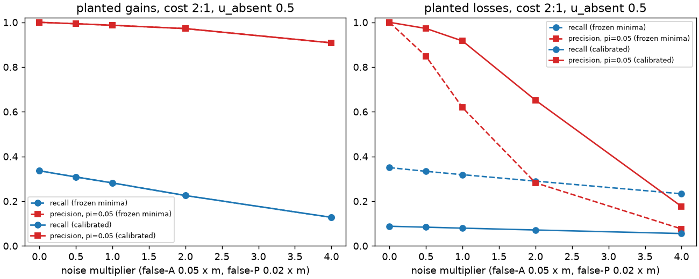
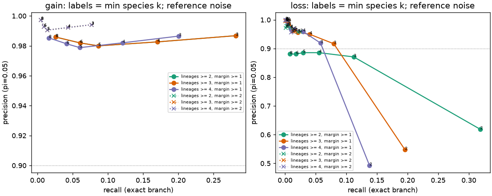

# SIM — Part B event engine: simulation, FDR calibration, toy end-to-end run

Generated 2026-10-30 13:32 UTC by `scripts/partB/write_sim_md.py`. prereg sha256 `52f9461890984c210b730af86c40de221307a668e7d4b38098b3316059690d83`; snapshot `20261030T085136Z` (development subset, preliminary); git `b3264dd789bab733c54badede43fa813134ca790+dirty`. **Simulated data only** — no real SOG states existed at writing. Observation-noise rates are **placeholders** (`noise_model_is_placeholder = True`) until measured rates from `results/observation/...` replace them (`run_sim.py --noise-json`); thresholds must then be re-derived.

## 1. Engine (code)

- `src/pocketevo/recon.py`: streaming OrthoXML -> per-root-HOG gene trees (orthologGroup = speciation, level = TaxRange; paralogGroup = duplication, level = taxon below the duplication; leaves = proteins; polytomies kept); NCBI guide tree parser; batched Sankoff (numba; down + up pass, single MPR with no-change tie-break, per-node conditional optimal costs -> unambiguous nodes and event margins); Dollo event count (M3); sidecars.
- `src/pocketevo/events.py`: event extraction with clade info (species below, informative members, outgroup lineages with A/P, levels, node kinds, deep flag, species-tree LCA), prereg gain/loss rules, calibrated cuts, funnel, yield preflight, residue-first specificity test (BLOSUM62 < 0 clade-consistent substitutions, covariate-regressed fingerprint shift vs noise floor, matched-depth empirical null, BH; clade permutation as secondary), FDR helpers, SOG-table loader/assembler.
- `src/pocketevo/simulate.py`: per-species noise model, vertical / planted gain / planted loss truth, masked curveball, species-matrix collapse + member remap, pseudo-clades, same-protein replicate trees.
- Drivers `scripts/partB/`: `build_hog_trees.py`, `run_sim.py`, `make_toy_sogs.py`, `run_events.py`, `run_nulls.py`, `eval_toy.py`, `write_sim_md.py`. Tests: `tests/test_recon.py`.

O1 HOG trees (`results/partB/hog_trees/O1/`): 36736 root HOGs, 750296 nodes, 451629 protein leaves, 71726 duplication and 226941 speciation nodes, 2538 roots are duplications; 15.4 % of internal nodes are polytomies; 25347 root HOGs have >= 3 species. Leaf sets and duplication counts of all root groups agree with `ancestra.orthoxml.read_orthoxml`; all leaf species and node levels exist in the guide tree.

### Interpretation choices (INTERP; for PI review)

1. **W = present-ambiguous**: W constrains the reconstruction like P (never absence) but never counts toward the species thresholds; it counts as present in the 80 % fraction of a gain and *against* a loss; state confidence 0.5. Sensitivity: `--w-mode missing|soft:<x>`.
2. **Outgroup lineage** of a member m = the child subtree of LCA(m, clade) that contains m (sister lineage, then successive outgroups) on the gene tree (paralog sister copies count).
3. **Event called only if unambiguous** (both endpoint states identical in every MPR). With 2:1 costs a gain is unique only when the alternative needs >= 3 losses; a gain at a child of the gene-tree root always reconstructs as a loss of the sister (no outgroup) — visible in the recall by clade below.
4. **Calibrated cuts never relax frozen minima**; the grid is min species in the derived clade k, min outgroup lineages supporting the ancestral state, min parsimony margin.
5. **Truth for precision** = the called clade is the planted clade or nested in it, same type ('consistent'); exact-branch precision ('strict') reported beside it. Recall = exact branch.
6. **FDR** = false/all calls in a mixture world: a fraction pi of SOGs carry one planted event (half gains, half losses), the rest are vertical. pi is unknown for real data: thresholds chosen at pi_ref = 0.05; on real SOGs FDR is re-estimated with `events.empirical_fdr` (expected false calls from the no-event simulation on the same trees with measured rates / observed calls).
7. **Curveball swaps** (prereg '100 x number of 1s'): counted as exchanged pairs (min(|A|,|B|) per curveball trade = equivalent checkerboard swaps), with the missing (U/G) mask held fixed.
8. **Specificity 'P throughout'** = >= 80 % of informative members P/W on both sides (A members left out); tested set for BH = pairs passing the residue-first gate; empirical null = shifts of the other sister pairs (no residue signal) matched on species-tree depth and derived-clade size (log2 bin).
9. **M3** on the species tree (SOG x species, strongest member state; Dollo); the gene-tree Dollo version is used inside the simulation.

## 2. Simulation design

25342 real O1 root-HOG trees (of 25347 with >= 3 species; <= 2000 leaves; seeded), 30 replicate SOGs per tree x world x setting = 13736250 simulated SOGs; runtime 78 s on 16 workers. Tree sizes: median 6 members / 4 species (max 1601). Worlds: vertical (no event), one planted gain (clade >= 3 species), one planted loss (clade >= 2 species); planted branches must have >= 2 outgroup lineages and >= 2 outgroup species.

Noise (per leaf): true present -> U 0.15, W 0.05, A (false-A) 0.05; true absent -> U 0.5, P (false-P) 0.02; per-species rates drawn from Beta(concentration 20.0). false-A = prereg rescue.false_A_target; the others are placeholders. Grid: noise multiplier m on false-A/false-P in [0.0, 0.5, 1.0, 2.0, 4.0]; u_absent in {0.2, 0.5, 0.8} at m = 1; costs 2:1 (all) and 1:1, 3:1 at m = 1.

## 3. Chosen thresholds (event FDR 0.10)

```json
{
 "prereg_sha256": "52f9461890984c210b730af86c40de221307a668e7d4b38098b3316059690d83",
 "event_fdr_target": 0.1,
 "pi_ref": 0.05,
 "reference_noise_multiplier": 1.0,
 "chosen": {
  "1:1": {
   "gain": {
    "min_species": 3,
    "min_margin": 1.0,
    "min_out_lineages": 2,
    "recall": 0.4264,
    "fdr": 0.0231,
    "fdr_strict": 0.0418,
    "recall_consistent": 0.4346,
    "false_calls_per_null_sog": 0.0002
   },
   "loss": {
    "min_species": 3,
    "min_margin": 1.0,
    "min_out_lineages": 2,
    "recall": 0.1086,
    "fdr": 0.0701,
    "fdr_strict": 0.0755,
    "recall_consistent": 0.1093,
    "false_calls_per_null_sog": 0.0001
   }
  },
  "2:1": {
   "gain": {
    "min_species": 3,
    "min_margin": 1.0,
    "min_out_lineages": 2,
    "recall": 0.2817,
    "fdr": 0.0132,
    "fdr_strict": 0.0359,
    "recall_consistent": 0.2883,
    "false_calls_per_null_sog": 0.0
   },
   "loss": {
    "min_species": 3,
    "min_margin": 1.0,
    "min_out_lineages": 3,
    "recall": 0.0795,
    "fdr": 0.0833,
    "fdr_strict": 0.1005,
    "recall_consistent": 0.0809,
    "false_calls_per_null_sog": 0.0001
   }
  },
  "3:1": {
   "gain": {
    "min_species": 3,
    "min_margin": 1.0,
    "min_out_lineages": 2,
    "recall": 0.1877,
    "fdr": 0.014,
    "fdr_strict": 0.0372,
    "recall_consistent": 0.1922,
    "false_calls_per_null_sog": 0.0
   },
   "loss": {
    "min_species": 3,
    "min_margin": 1.0,
    "min_out_lineages": 4,
    "recall": 0.0571,
    "fdr": 0.0879,
    "fdr_strict": 0.1159,
    "recall_consistent": 0.0588,
    "false_calls_per_null_sog": 0.0001
   }
  }
 }
}
```

Full record: `results/partB/sim/thresholds.json` (with sidecar). Applied by `run_events.py` / `run_nulls.py` via `events.rules_by_cost`; the file's prereg hash is checked at load.

Frozen prereg minima vs calibrated cuts at the reference noise (m = 1, u_absent 0.5, pi = 0.05):

| cost | type | frozen_recall | frozen_FDR | frozen_false_per_null_SOG | cal_k | cal_lineages | cal_margin | cal_recall | cal_FDR | cal_FDR_strict | cal_false_per_null_SOG | cal+f1_recall | cal+f1_FDR |
|---|---|---|---|---|---|---|---|---|---|---|---|---|---|
| 2:1 | gain | 0.2817 | 0.0132 | 0.0000 | 3 | 2 | 1.0000 | 0.2817 | 0.0132 | 0.0359 | 0.0000 | 0.2787 | 0.0124 |
| 2:1 | loss | 0.3186 | 0.3812 | 0.0044 | 3 | 3 | 1.0000 | 0.0795 | 0.0833 | 0.1005 | 0.0001 | 0.0784 | 0.0688 |
| 1:1 | gain | 0.4264 | 0.0231 | 0.0002 | 3 | 2 | 1.0000 | 0.4264 | 0.0231 | 0.0418 | 0.0002 | 0.4249 | 0.0187 |
| 1:1 | loss | 0.3051 | 0.3618 | 0.0042 | 3 | 2 | 1.0000 | 0.1086 | 0.0701 | 0.0755 | 0.0001 | 0.1075 | 0.0672 |
| 3:1 | gain | 0.1877 | 0.0140 | 0.0000 | 3 | 2 | 1.0000 | 0.1877 | 0.0140 | 0.0372 | 0.0000 | 0.1838 | 0.0133 |
| 3:1 | loss | 0.3173 | 0.4257 | 0.0044 | 3 | 4 | 1.0000 | 0.0571 | 0.0879 | 0.1159 | 0.0001 | 0.0563 | 0.0718 |

## 4. Precision / recall vs noise (cost 2:1, calibrated cuts; pi = 0.05)

| type | cuts | noise_mult | false_A | recall | precision | precision_strict | false_calls_per_null_SOG |
|---|---|---|---|---|---|---|---|
| gain | frozen | 0.0000 | 0.0000 | 0.3360 | 1.0000 | 1.0000 | 0.0000 |
| gain | calibrated | 0.0000 | 0.0000 | 0.3360 | 1.0000 | 1.0000 | 0.0000 |
| gain | frozen | 0.5000 | 0.0250 | 0.3083 | 0.9936 | 0.9817 | 0.0000 |
| gain | calibrated | 0.5000 | 0.0250 | 0.3083 | 0.9936 | 0.9817 | 0.0000 |
| gain | frozen | 1.0000 | 0.0500 | 0.2817 | 0.9868 | 0.9641 | 0.0000 |
| gain | calibrated | 1.0000 | 0.0500 | 0.2817 | 0.9868 | 0.9641 | 0.0000 |
| gain | frozen | 2.0000 | 0.1000 | 0.2254 | 0.9720 | 0.9240 | 0.0000 |
| gain | calibrated | 2.0000 | 0.1000 | 0.2254 | 0.9720 | 0.9240 | 0.0000 |
| gain | frozen | 4.0000 | 0.2000 | 0.1276 | 0.9081 | 0.8083 | 0.0002 |
| gain | calibrated | 4.0000 | 0.2000 | 0.1276 | 0.9081 | 0.8083 | 0.0002 |
| loss | frozen | 0.0000 | 0.0000 | 0.3502 | 1.0000 | 1.0000 | 0.0000 |
| loss | calibrated | 0.0000 | 0.0000 | 0.0879 | 1.0000 | 1.0000 | 0.0000 |
| loss | frozen | 0.5000 | 0.0250 | 0.3336 | 0.8483 | 0.8433 | 0.0012 |
| loss | calibrated | 0.5000 | 0.0250 | 0.0837 | 0.9725 | 0.9631 | 0.0000 |
| loss | frozen | 1.0000 | 0.0500 | 0.3186 | 0.6188 | 0.6114 | 0.0044 |
| loss | calibrated | 1.0000 | 0.0500 | 0.0795 | 0.9167 | 0.8995 | 0.0001 |
| loss | frozen | 2.0000 | 0.1000 | 0.2898 | 0.2822 | 0.2751 | 0.0179 |
| loss | calibrated | 2.0000 | 0.1000 | 0.0712 | 0.6517 | 0.6262 | 0.0007 |
| loss | frozen | 4.0000 | 0.2000 | 0.2331 | 0.0761 | 0.0716 | 0.0736 |
| loss | calibrated | 4.0000 | 0.2000 | 0.0554 | 0.1765 | 0.1603 | 0.0065 |





U-rate sensitivity (calibrated cuts, m = 1): recall depends mostly on how often true absences are observable (A needs footprint pLDDT >= 90).

| u_absent | type | recall | FDR |
|---|---|---|---|
| 0.2000 | gain | 0.3872 | 0.0125 |
| 0.2000 | loss | 0.1605 | 0.0657 |
| 0.5000 | gain | 0.2817 | 0.0132 |
| 0.5000 | loss | 0.0795 | 0.0833 |
| 0.8000 | gain | 0.1342 | 0.0124 |
| 0.8000 | loss | 0.0170 | 0.2691 |

FDR of the chosen cuts vs the planted fraction pi:

| type | FDR_pi0.02 | FDR_pi0.05 | FDR_pi0.1 | FDR_pi0.2 |
|---|---|---|---|---|
| gain | 0.0140 | 0.0132 | 0.0130 | 0.0128 |
| loss | 0.1277 | 0.0833 | 0.0675 | 0.0594 |

Recall by planted clade size and parent node kind (2:1, calibrated cuts, m = 1):

| type | parent_kind | clade_leaves | n_planted | recall |
|---|---|---|---|---|
| gain | duplication | <=3 | 23026 | 0.216 |
| gain | duplication | 4-5 | 32899 | 0.366 |
| gain | duplication | 6-10 | 21881 | 0.536 |
| gain | duplication | 11-20 | 6946 | 0.633 |
| gain | duplication | 21-50 | 1849 | 0.725 |
| gain | duplication | >50 | 366 | 0.727 |
| gain | speciation | <=3 | 60173 | 0.117 |
| gain | speciation | 4-5 | 72166 | 0.212 |
| gain | speciation | 6-10 | 55716 | 0.318 |
| gain | speciation | 11-20 | 15054 | 0.398 |
| gain | speciation | 21-50 | 5667 | 0.424 |
| gain | speciation | >50 | 837 | 0.380 |
| loss | duplication | <=3 | 94131 | 0.012 |
| loss | duplication | 4-5 | 30009 | 0.124 |
| loss | duplication | 6-10 | 15095 | 0.287 |
| loss | duplication | 11-20 | 3704 | 0.457 |
| loss | duplication | 21-50 | 1138 | 0.549 |
| loss | duplication | >50 | 204 | 0.583 |
| loss | speciation | <=3 | 218460 | 0.010 |
| loss | speciation | 4-5 | 54354 | 0.117 |
| loss | speciation | 6-10 | 38107 | 0.281 |
| loss | speciation | 11-20 | 10086 | 0.420 |
| loss | speciation | 21-50 | 3658 | 0.517 |
| loss | speciation | >50 | 464 | 0.483 |

## 5. M3 under noisy-but-vertical evolution (gene-tree Dollo, fraction of SOGs with <= 1 event)

| noise | u_absent | n | frac_le1 |
|---|---|---|---|
| 0.0000 | 0.5000 | 759779.0000 | 1.0000 |
| 0.5000 | 0.5000 | 759524.0000 | 0.9396 |
| 1.0000 | 0.2000 | 759202.0000 | 0.8693 |
| 1.0000 | 0.5000 | 759235.0000 | 0.8689 |
| 1.0000 | 0.8000 | 759270.0000 | 0.8682 |
| 2.0000 | 0.5000 | 758167.0000 | 0.7583 |
| 4.0000 | 0.5000 | 754534.0000 | 0.6150 |

## 6. End-to-end toy run (real input layout, known truth)

`make_toy_sogs.py`: 400 O1 OGs, 800 SOGs in the sogs-web-v1 layout (with G rows, replicate observations, footprint residues, fingerprints with a volume covariate effect, replicate cosines). `run_events.py` -> `eval_toy.py`:

| cost | type | planted | called | precision | precision_strict | recall | false_in_vertical_SOGs |
|---|---|---|---|---|---|---|---|
| 2:1 | gain | 124 | 35 | 1.000 | 0.943 | 0.266 | 0 |
| 2:1 | loss | 100 | 23 | 1.000 | 1.000 | 0.230 | 0 |
| 1:1 | gain | 124 | 58 | 1.000 | 0.966 | 0.452 | 0 |
| 1:1 | loss | 100 | 33 | 1.000 | 1.000 | 0.330 | 0 |
| 3:1 | gain | 124 | 23 | 1.000 | 0.913 | 0.169 | 0 |
| 3:1 | loss | 100 | 13 | 1.000 | 1.000 | 0.130 | 0 |

Specificity (planted: 3 BLOSUM62<0 clade-consistent substitutions + fingerprint shift): 4582 sister pairs, 76 passed the residue gate (BH set), 63/63 planted reached the test, 35 called, 35 true -> precision 1.000, recall 0.556.

Null-input pipeline on the toy table (`run_nulls.py`, same code and thresholds, cost 2:1, prereg seeds). Columns are cumulative stages; for specificity: species = residue gate, frac = residue + shift > floor, candidate = BH-tested, called = BH q <= 0.05 and shift > floor.

| input | seed | type | n_sogs | clade_size_ok | unambiguous | species | frac | outgroup | candidate | called | called_f1_single_event | called_false_by_construction |
|---|---|---|---|---|---|---|---|---|---|---|---|---|
| real | – | gain | 800 | 56 | 45 | 36 | 35 | 35 | 35 | 35 | 34 | – |
| real | – | loss | 800 | 135 | 70 | 68 | 68 | 58 | 58 | 23 | 22 | – |
| real | – | specificity | 800 | 4582 | – | 76 | 35 | – | 76 | 35 | – | – |
| null_curveball | 0 | gain | 800 | 17 | 12 | 7 | 2 | 2 | 2 | 2 | 2 | – |
| null_curveball | 0 | loss | 800 | 168 | 84 | 74 | 73 | 68 | 68 | 17 | 9 | – |
| null_pseudo_clade | 0 | gain | 800 | 13 | 10 | 1 | 0 | 0 | 0 | 0 | 0 | – |
| null_pseudo_clade | 0 | loss | 800 | 112 | 66 | 65 | 64 | 58 | 58 | 15 | 6 | – |
| null_pseudo_clade | 0 | specificity | 800 | 4466 | – | 15 | 0 | – | 15 | 0 | – | – |
| null_curveball | 1 | gain | 800 | 33 | 21 | 12 | 4 | 4 | 4 | 4 | 3 | – |
| null_curveball | 1 | loss | 800 | 153 | 104 | 102 | 98 | 89 | 89 | 17 | 10 | – |
| null_pseudo_clade | 1 | gain | 800 | 15 | 11 | 4 | 0 | 0 | 0 | 0 | 0 | – |
| null_pseudo_clade | 1 | loss | 800 | 119 | 67 | 67 | 67 | 63 | 63 | 10 | 2 | – |
| null_pseudo_clade | 1 | specificity | 800 | 4448 | – | 9 | 0 | – | 9 | 0 | – | – |
| null_curveball | 2 | gain | 800 | 29 | 20 | 9 | 4 | 4 | 4 | 4 | 2 | – |
| null_curveball | 2 | loss | 800 | 164 | 93 | 88 | 83 | 73 | 73 | 17 | 8 | – |
| null_pseudo_clade | 2 | gain | 800 | 13 | 10 | 1 | 1 | 1 | 1 | 1 | 1 | – |
| null_pseudo_clade | 2 | loss | 800 | 124 | 75 | 75 | 73 | 68 | 68 | 15 | 3 | – |
| null_pseudo_clade | 2 | specificity | 800 | 4442 | – | 14 | 1 | – | 14 | 1 | – | – |
| null_replicate | – | gain | 800 | 125 | 94 | 79 | 77 | 77 | 77 | 77 | 2 | 0 |
| null_replicate | – | loss | 800 | 248 | 140 | 138 | 138 | 138 | 138 | 60 | 8 | 0 |

M3 (species tree, toy): real 0.650 (n = 799); curveball null mean 0.566 [0.558, 0.574], 1000 replicates, p(null >= real) = 0.0010; vertical-noisy expectation 0.637 +- 0.015.

## 7. Findings and caveats

- The prereg minima alone keep gains well under the FDR target, but **2-species losses are noise-dominated** (FDR 0.38 at the reference noise: two false-A sister species mimic a loss). Calibration raises the loss cut to k = 3 species / >= 3 P outgroup lineages; this costs recall (loss recall 0.079 vs gain 0.282).
- Null-input funnel (toy, §6): gains separate cleanly from nulls, but **loss calls survive the curveball and pseudo-clade nulls at a substantial rate** (SOGs with many A members arranged at random still contain small all-A clades). The f1 persistence filter (single event spanning >= 2 species) removes most null losses while keeping nearly all true calls; it is a frozen evidence filter, so it is applied downstream anyway, and the funnel reports it as `called_f1_single_event`. Recommend the PI treat loss candidates as reportable only after f1 and the empirical-FDR check on real data.
- Recall is bounded by observability (u_absent) and by parsimony identifiability (unique MPR needed), not by the thresholds; recall rises steeply with clade size.
- No-event worlds produce essentially no calls at the chosen cuts (false calls per null SOG in §3), so FDR on real data will be driven by misplaced/polarisation errors around true events and by the real noise rates, which are still placeholders.
- Not covered here (other stages): simulated losses from masked pLDDT/truncation must become U (state caller), rescue, artifact cascade, uricase/GULO G controls.
- To do when real inputs arrive: (1) `run_sim.py --noise-json <measured rates>` on the O2 trees -> new thresholds.json; (2) `run_events.py` + `run_nulls.py` on `results/sogs/<snapshot>/O2` (primary, then secondary stratum if the yield preflight says so); (3) empirical FDR check with `events.empirical_fdr`; (4) noise floor from measured same-site replicate cosines.

## 8. Re-derived thresholds on MEASURED noise (D9 rescue k = 1; D11 A needs > 10 footprint residues)

Noise JSONs: `results/partB/sim/measured/noise_*.json` (`scripts/partB/make_noise_json.py`: per-species miss rate on known sites, rescue residual and control-rescue (false-W on true absences, 0.35) from error_rates.parquet, A-eligibility per species from the real states). `d11_*` runs use the D11 states and the > 10-residue rates and are the ones applied to real SOGs (pre-D11 runs were superseded and removed).

| run | cost | type | false_A | u_absent | w_absent | k | lineages | margin | recall | FDR |
|---|---|---|---|---|---|---|---|---|---|---|
| d11_primary_known_gt10 | 1:1 | gain | 0.0049 | 0.9789 | 0.3500 | 3 | 2 | 1.0000 | 0.0074 | 0.0562 |
| d11_primary_known_gt10 | 1:1 | loss | 0.0049 | 0.9789 | 0.3500 | 2 | 2 | 2.0000 | 0.0000 | 0.0000 |
| d11_primary_known_gt10 | 2:1 | gain | 0.0049 | 0.9789 | 0.3500 | 3 | 2 | 1.0000 | 0.0012 | 0.0507 |
| d11_primary_known_gt10 | 2:1 | loss | 0.0049 | 0.9789 | 0.3500 | 2 | 3 | 2.0000 | 0.0000 | 0.0000 |
| d11_primary_known_gt10 | 3:1 | gain | 0.0049 | 0.9789 | 0.3500 | 3 | 2 | 1.0000 | 0.0003 | 0.0505 |
| d11_primary_known_gt10 | 3:1 | loss | 0.0049 | 0.9789 | 0.3500 | 2 | 3 | 2.0000 | 0.0000 | 0.0000 |
| d11_primary_redetect_gt10 | 1:1 | gain | 0.0032 | 0.9789 | 0.3500 | 3 | 2 | 1.0000 | 0.0081 | 0.0537 |
| d11_primary_redetect_gt10 | 1:1 | loss | 0.0032 | 0.9789 | 0.3500 | 3 | 4 | 1.0000 | 0.0000 | 0.0000 |
| d11_primary_redetect_gt10 | 2:1 | gain | 0.0032 | 0.9789 | 0.3500 | 3 | 2 | 1.0000 | 0.0013 | 0.0488 |
| d11_primary_redetect_gt10 | 2:1 | loss | 0.0032 | 0.9789 | 0.3500 | 2 | 3 | 2.0000 | 0.0000 | 0.0000 |
| d11_primary_redetect_gt10 | 3:1 | gain | 0.0032 | 0.9789 | 0.3500 | 3 | 2 | 1.0000 | 0.0003 | 0.0476 |
| d11_primary_redetect_gt10 | 3:1 | loss | 0.0032 | 0.9789 | 0.3500 | 2 | 3 | 2.0000 | 0.0000 | 0.0000 |

With measured rates true absences are almost never observable as A (u_absent ~ 0.92 before, ~ 0.98 after D11) and 35 % of observable ones are rescued to W, so recall of planted gains is ~0.1-0.5 % and of planted losses ~0: no loss cut reaches useful recall at FDR 0.10.
